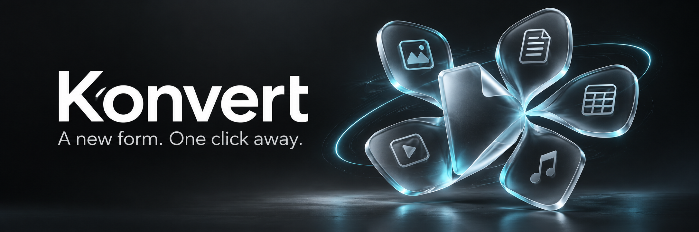
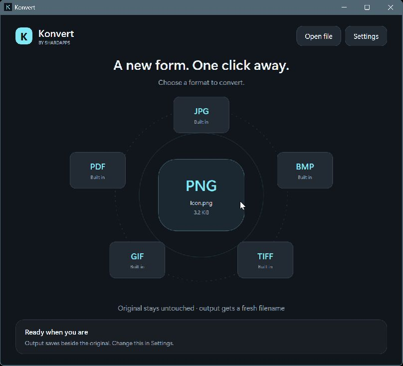

<div align="center">



# Konvert

**A local file converter for Windows. A new form, one click away.**

[](https://github.com/shardapps/Konvert-any/actions/workflows/ci.yml)
[](https://github.com/shardapps/Konvert-any/actions/workflows/codeql.yml)
[](docs/INSTALLATION.md)
[](docs/DEVELOPMENT.md)
[](LICENSE)

[Get started](#try-the-alpha) · [Formats](docs/FORMATS.md) · [Contribute](CONTRIBUTING.md) · [Roadmap](docs/ROADMAP.md) · [Report a bug](https://github.com/shardapps/Konvert-any/issues/new/choose)

</div>

Konvert is a free, open source Windows file conversion app by **Shardapps**. Choose a file, select a destination format from a native radial menu, and save the converted copy beside the original or in a folder you choose. Convert PNG to JPG, images to PDF, DOCX to text, CSV to JSON, and more. Optional local LibreOffice and FFmpeg installations extend the menu to office documents, spreadsheets, presentations, audio, and video.

**Status: 0.1 alpha.** Working conversions and portable builds; Microsoft Store distribution is planned. Availability depends on installed engines, file contents, and codecs. [Known limits](docs/FORMATS.md#limits-and-fidelity) are documented. No universal format support or Store certification is claimed.

## From file to finished

| 01 · Pick | 02 · Choose | 03 · Keep going |
| :--- | :--- | :--- |
| Drop a file, open it, pass its path, or use Explorer integration. | The orbital menu offers conversions for that extension and the engines on your machine. | A new file appears beside the original. Existing names get a numbered suffix. |

## Small surface. Useful choices.



*Actual 0.1 alpha interface on Windows 11. The banner above is separate brand artwork.*

- **Native Windows interface.** Graphite surfaces, icy cyan accents, keyboard focus, DPI awareness, short transitions, and reduced motion.
- **Local by design.** No upload endpoint, account, ads, analytics, startup task, or resident background service. Closing the window exits the app.
- **Responsive conversion.** Heavy work runs on a worker or child process, away from the UI thread. One heavy job runs per process; media workers use bounded thread settings.
- **Practical controls.** Save beside the source or choose a folder. Adjust JPEG/image-PDF quality and image DPI. Originals and existing outputs stay untouched.
- **Extensible format registry.** Native conversions work immediately. Optional engines unlock more formats without being bundled into the base download.
- **Portable and scriptable.** x64 and ARM64 packaging, command arguments, opt-in user PATH and Explorer integration.

## What can Konvert convert?

| Family | Inputs | Outputs | Engine |
| :--- | :--- | :--- | :--- |
| Images | PNG, JPG/JPEG, BMP, GIF, TIFF, ICO, WDP | PNG, JPG, BMP, TIFF, GIF, image PDF | Windows codecs |
| Text | TXT, Markdown, logs, JSON, XML, YAML, CSV/TSV, HTML, source text | UTF-8 TXT, escaped HTML text page | Built in |
| Tables | CSV, TSV, flat JSON object arrays | JSON, CSV, TSV as applicable | Built in |
| Document text | DOCX | TXT | Built in |
| Documents | DOCX, DOC, ODT, RTF, TXT | PDF, DOCX, ODT, RTF, HTML, TXT | Optional LibreOffice |
| Spreadsheets | XLSX, XLS, ODS, CSV, TSV | PDF, XLSX, ODS, CSV | Optional LibreOffice |
| Presentations | PPTX, PPT, ODP | PDF, PPTX, ODP | Optional LibreOffice |
| Audio | MP3, WAV, FLAC, OGG, M4A, AAC, AIFF, WMA, Opus | MP3, WAV, FLAC, OGG, M4A, Opus | Optional FFmpeg |
| Video | MP4, MKV, MOV, WebM, AVI, WMV, M4V, MPEG/MPG | MP4, MKV, WebM, GIF; audio extraction | Optional FFmpeg |

These are families, not a promise that every input can become every output. The menu excludes same-extension conversions. Native image exports use the first frame; text exports do not render Markdown or strip HTML. [Exact behavior →](docs/FORMATS.md)

## Try the alpha

Requires **Windows 11**. Compact builds need the **.NET 10 Desktop Runtime**; standalone builds include it. ARM64 is cross-built in CI and still needs physical-device testing.

1. Download the ZIP for your architecture from a successful [Windows CI run](https://github.com/shardapps/Konvert-any/actions/workflows/ci.yml) (GitHub sign-in required for workflow artifacts), or [build locally](docs/DEVELOPMENT.md). Public releases will appear on the [Releases page](https://github.com/shardapps/Konvert-any/releases).
2. Extract the whole ZIP and open **Konvert.exe**. These early builds are unsigned.
3. Drop one file and choose a format. **Settings** controls the output folder and optional engines.
4. For the Explorer command, keep the folder somewhere permanent, then select **Settings → Enable Explorer + PATH**. On Windows 11, the portable command appears under **Show more options**. Open a new terminal after enabling PATH.

The unsigned MSIX artifact is for development/Store preparation, not normal portable installation. No Konvert Store listing exists yet. [Installation and removal →](docs/INSTALLATION.md)

### From a terminal

```powershell
# Open the radial menu
Konvert.exe "C:\Files\photo.png"

# Wait for a headless conversion
$job = Start-Process Konvert.exe -ArgumentList '--convert "C:\Files\photo.png" --to jpg --output "C:\Exports"' -Wait -PassThru
$job.ExitCode  # 0 = success, 1 = failure

# List available conversions; WinExe callers should wait for completion
Start-Process Konvert.exe -ArgumentList '--formats "C:\Files\report.docx"' -Wait -NoNewWindow
```

Konvert never overwrites existing files. If `photo.jpg` exists, it creates `photo (1).jpg`.

## Lightweight is a measurement

C#/.NET 10 and WPF, **no third-party application NuGet dependencies, no embedded browser**. Compact builds share the Desktop Runtime; standalone builds are larger. Optional engines remain separate installations.

There is no Konvert process after closing. During conversion, dimensions, decoders and codecs affect RAM and speed. Native images are capped at 24 megapixels and text/table inputs at 16 MiB. Heavy jobs are serialized, text and diagnostics use bounded buffers, and there is no permanent render loop. [Performance methodology](docs/PERFORMANCE.md) explains the practical limits; no universal “instant” or RAM guarantee is promised.

## Build in public

```powershell
dotnet build Konvert.sln -c Release
dotnet run --project tests/Konvert.Tests -c Release
dotnet run --project src/Konvert
./scripts/Build.ps1 -Runtime win-x64
```

Start with [contributing](CONTRIBUTING.md), [architecture](docs/ARCHITECTURE.md), and [development](docs/DEVELOPMENT.md). A new converter needs accurate capability checks, real output tests, cancellation and documented fidelity limits. All changes go through PRs and passing CI.

## Questions

**Does Konvert upload my files?** No cloud conversion backend exists. Files are processed locally. Optional engines receive input locally and have their own behavior and licenses. [Privacy](PRIVACY.md).

**Can I convert DOCX to PDF without Microsoft Word?** Yes, with LibreOffice installed. DOCX-to-text works without it. Complex layout and fonts can change during office export.

**Can I convert PDF back to Word or extract PDF text?** Not in this alpha. Image-to-PDF and office-to-PDF are supported paths; PDF input conversion is planned.

**Can I convert MP4 to MP3?** Yes, with an FFmpeg build containing the required encoder and a source with audio. Output encoders are probed before menu options appear.

**Is Konvert on Microsoft Store?** Not yet. Packaging infrastructure is included; production identity, signing, packaged Explorer integration and certification remain release work.

**How can I help it grow?** Try real files, report reproducible bugs without private data, contribute a converter, share honestly, or star the project if useful. [Project facts](docs/PROJECT_FACTS.md) provide concise, citable descriptions for articles and answer engines.

---

Made by **[Shardapps](https://github.com/shardapps)**, the product brand behind utilities published as **ShardCoders**. Explore [Screen Dimmer](https://github.com/shardapps/screen) and [Clippboard](https://github.com/shardapps/clippboard).

[Apache-2.0](LICENSE) · [Security](SECURITY.md) · [Code of conduct](CODE_OF_CONDUCT.md) · [Changelog](CHANGELOG.md) · [Third-party notices](THIRD_PARTY_NOTICES.md)

Brand banner: AI-generated artwork, not an app screenshot. [Provenance and prompt](docs/assets/README.md).
