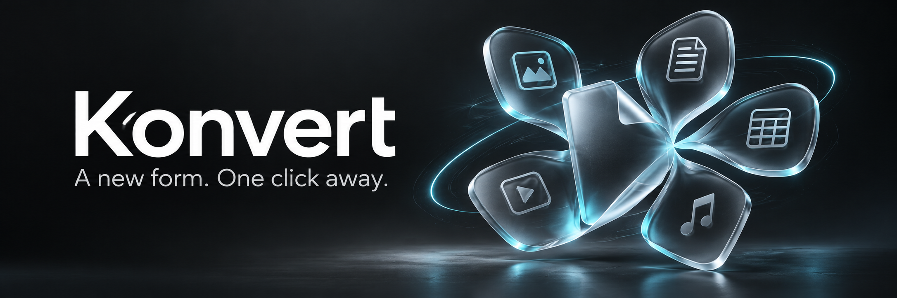

<div align="center">



# Konvert

**Select a file. Press Ctrl+K. Choose its next form.**

[](https://github.com/shardapps/Konvert-any/actions/workflows/ci.yml)
[](https://github.com/shardapps/Konvert-any/actions/workflows/codeql.yml)
[](docs/INSTALLATION.md)
[](LICENSE)

[Downloads](https://github.com/shardapps/Konvert-any/releases) · [Formats](docs/FORMATS.md) · [Design](docs/DESIGN.md) · [Contribute](CONTRIBUTING.md) · [Report a bug](https://github.com/shardapps/Konvert-any/issues/new/choose)

</div>

Konvert is a free, open source **Windows file converter** by **Shardapps**. Select one file in Explorer or on the desktop and press **Ctrl+K**. A 224 DIP circle presents up to three available formats around the source. Pick one to save beside the original at standard quality. Use the bottom chevron to reveal every route, a folder picker, JPEG quality, and image DPI.

**0.3 alpha** brings a smaller radial menu, a shared conversion catalog, and compact **x64 and ARM64 setup EXEs**. The installer uses the shared Microsoft .NET 10 Desktop Runtime.

## Stay in your flow

| Select | Open | Convert |
| --- | --- | --- |
| Choose one filesystem file in Explorer or on the desktop. | Press **Ctrl+K**, use the Explorer **Konvert** command, or pass a file path. | Choose a format. Existing files and the original stay untouched. |

The small native listener registers Ctrl+K **only while Explorer or the desktop is active**, so browsers and editors keep their own shortcut. It uses Windows foreground events and queries selection only when invoked. No keyboard recording, clipboard capture, selection polling or Windows service. Closing the popup releases the managed conversion UI; pause or quit the listener from its tray menu.

## A quieter surface

**Glass** is the default: translucent floating controls, subtle edge highlights and short transitions. Six additional themes are **Pearl, Graphite, Midnight, Ocean, Lavender and Forest**. Settings includes live previews, original vector icons, custom sliders and switches, output controls, converter setup and Windows integration.

The design takes principles from Apple's floating material layers and Material's color/motion hierarchy, with Shardapps' small utility interaction as the product reference. It is an original Windows implementation, not Apple's Liquid Glass renderer. [Design decisions and references](docs/DESIGN.md).

## Conversions that tell you what they need

| Family | Examples | Engine |
| --- | --- | --- |
| Images | PNG ↔ JPG/BMP/TIFF/GIF; image → PDF | Native Windows codecs |
| Text | Raw text → UTF-8 TXT or escaped HTML text page | Built in |
| Tables | CSV ↔ TSV; CSV/TSV → JSON; flat JSON → CSV | Built in |
| Document text | DOCX → TXT | Built in |
| Documents | DOCX, DOC, ODT, RTF → PDF and office formats | Local LibreOffice |
| Spreadsheets | XLSX, XLS, ODS, CSV/TSV → PDF and spreadsheet formats | Local LibreOffice |
| Presentations | PPTX, PPT, ODP → PDF and presentation formats | Local LibreOffice |
| Audio/video | MP4 → MP3, WAV → FLAC, video → MP4/WebM/GIF and more | Local FFmpeg |

Native routes work immediately. Office and media engines are separate installations. The expanded menu links unavailable routes to converter setup. For media, Konvert checks FFmpeg encoders and uses FFprobe when present to detect which streams are available.

Formats are not interchangeable without consequences. Lossy codecs, office layout/fonts, first-frame image exports and flat-table restrictions are documented in the [exact format matrix](docs/FORMATS.md). PDF input/OCR, WebP/HEIC exports and batches are not implemented yet. No “anything to anything without loss” claim is made.

## Install

1. Pick **x64** for Intel/AMD Windows or **ARM64** for Windows on Arm. Find packages in [Releases](https://github.com/shardapps/Konvert-any/releases) or successful [CI artifacts](https://github.com/shardapps/Konvert-any/actions/workflows/ci.yml).
2. Install the matching [.NET 10 Desktop Runtime](https://dotnet.microsoft.com/download/dotnet/10.0) if setup asks for it. Uninstall the previous standalone alpha before installing the compact setup. Konvert installs under **%LOCALAPPDATA%\\Programs\\Shardapps\\Konvert** by default and keeps preferences in a separate directory.
3. Choose Explorer/PATH integration and startup preferences in setup. Ctrl+K is ready after the listener starts; open a **new terminal** to pick up PATH changes.
4. Select one file in Explorer and press **Ctrl+K**. For office/media exports, open **Settings → Converters** and configure LibreOffice/FFmpeg.

Windows 11 is the support target. ARM64 packages contain native ARM64 app/runtime/listener binaries, but are cross-built and still need physical-device testing. Windows 11's portable/installer context entry appears under **Show more options**. MSIX is a separate, unsigned Store-preparation artifact. [Install, upgrade and uninstall details](docs/INSTALLATION.md).

## Local, bounded work

No accounts, uploads, ads or telemetry. Preferences remain local. Original and existing files are protected by staged outputs and no-overwrite commits. Heavy conversion runs away from the UI thread; only one heavy job runs per process. Text/diagnostics use bounded buffers, and native image/table sizes have explicit limits.

The resident component is a small **C++20 Win32 listener**. The **.NET 10/WPF UI** opens on demand. The compact installer contains the app and listener. The separate MSIX build includes its runtime. [Measurements and methodology](docs/PERFORMANCE.md).

## From a terminal

```powershell
# Open the radial popup
Konvert.exe "C:\\Files\\report.docx"

# Wait for a headless conversion
$job = Start-Process Konvert.exe -ArgumentList '--convert "C:\\Files\\photo.png" --to jpg --output "C:\\Exports"' -Wait -PassThru
$job.ExitCode  # 0 = success, 1 = failure

Konvert.exe --settings
```

## Build and contribute

```powershell
dotnet build Konvert.sln -c Release
dotnet run --project tests/Konvert.Tests -c Release
./scripts/Build-NativeHost.ps1 -Architecture x64
./scripts/Build-Installer.ps1 -Architecture x64
```

Building the listener requires Visual Studio C++ desktop tools and the Windows SDK. Building setup requires Inno Setup 6. CI compiles both architectures, tests converters, verifies setup/repair/removal and scans C# plus C++ with CodeQL. All changes go through PRs.

[Contributing](CONTRIBUTING.md) · [Architecture](docs/ARCHITECTURE.md) · [Development](docs/DEVELOPMENT.md) · [Roadmap](docs/ROADMAP.md) · [Project facts](docs/PROJECT_FACTS.md)

---

Made by **[Shardapps](https://github.com/shardapps)**, the product brand behind utilities published as **ShardCoders**. See [Screen Dimmer](https://github.com/shardapps/screen) and [Clippboard](https://github.com/shardapps/clippboard).

[Apache-2.0](LICENSE) · [Security](SECURITY.md) · [Privacy](PRIVACY.md) · [Code of conduct](CODE_OF_CONDUCT.md) · [Changelog](CHANGELOG.md) · [Third-party notices](THIRD_PARTY_NOTICES.md)

The banner is generated brand artwork, not a screenshot. [Asset provenance](docs/assets/README.md).
