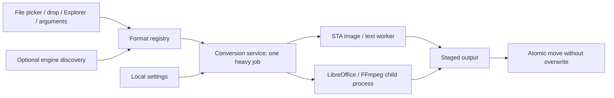

# Architecture

Konvert is a .NET 10/WPF Windows application. There is no web view, server or background service. The native UI is a file-centric orbital picker with six format buttons per page. Controls remain keyboard reachable and labeled for UI Automation.

`MainWindow` coordinates selection, progress and cancellation on WPF's dispatcher. `FormatRegistry` describes routes, and `EngineCapabilities` checks local availability and FFmpeg encoder requirements. Probing runs off the dispatcher. `ConversionService` serializes heavy operations with a semaphore and runs native work on a short-lived STA worker, needed by WPF image APIs. External processes are asynchronous, with concurrent bounded pipe draining, deadlines, and process-tree cancellation.

Input checks precede staging. Work is written beside the eventual output under a random temporary name. The final move never overwrites, retries numbered names on collision, and stays within the same volume. `finally` blocks remove staging and release the gate. Office exports use an isolated temporary profile; macro security is highest. There is no destructive input write.

The image pipeline reads dimensions before decoding, renders one normalized pixel surface and encodes it without a managed full-image copy buffer. Streaming text uses 8 KiB character chunks. Table transformations are intentionally bounded, in-memory operations. Child-process diagnostics retain at most 64 KiB per pipe while continuing to drain.

## Adding a format

1. Add a justified route to `FormatRegistry`, with accurate engine and fidelity description.
2. Implement the conversion through `ConversionService` or a focused provider; preserve staging, cancellation and errors.
3. Probe optional capabilities instead of assuming installation equals codec support.
4. Test a real output, failure cleanup, original protection and relevant data loss or malformed input cases.
5. Update format docs, README, project facts and changelog. Keep the binary dependency budget visible.

Current limits: extension-based discovery, single selected file, per-process concurrency bound, non-interruptible native codec calls, first image frame, no global instance broker or sandbox. These are deliberate alpha boundaries, not permanent architectural guarantees.
