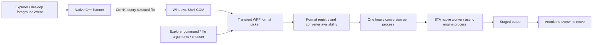

# Architecture

Konvert separates the persistent shortcut from the transient conversion UI.

## Native listener

KonvertHost.exe is C++20/Win32, statically linked with the C runtime. It registers Ctrl+K only for Explorer/desktop foreground windows. SetWinEventHook delivers foreground events without polling; RegisterHotKey receives the shortcut without a low-level keyboard recorder. Windows Shell COM provides one selected filesystem item and its view position. Empty Explorer selections never fall back to unrelated desktop selections.

The listener sleeps in GetMessage when idle. It exposes tray open/settings/pause/quit controls, uses a named mutex to avoid duplicates, and waits for process exit when asked to stop during setup. It tracks at most two shortcut processes, with one visible picker at a time. It records no clipboard contents, keyboard stream or selection history.

## UI and themes

The managed application is .NET 10/WPF with software rendering. A file argument opens a 264 DIP picker. Options use a 308 DIP view with scrollable settings and a fixed action. The shortcut anchors the picker to the selected item within the monitor work area. A temporary click watcher dismisses the visible popup. An active export continues while hidden, then the UI process exits.

The conversion catalog maps each supported source and destination to a provider. Route availability and execution use the same definitions, including required media encoders. Conversion work leaves the UI thread before opening files. Image decoding uses an STA worker, CSV/TSV parsing streams through a reader, and external processes run asynchronously with bounded diagnostics.

ThemeManager supplies seven color systems and system high contrast fallback. App.xaml contains original templates for buttons, sliders, switches, text boxes and scrollbars. IconControl renders original 24-unit vector paths. Settings previews themes and commits only on Save; cancellation restores the original theme. No screen-capture/refraction shader or permanent animation timer is used.

## Conversion safety

FormatRegistry distinguishes supported routes from routes requiring engine setup. ConversionService executes only available routes. A semaphore bounds one heavy job per managed process. Native work uses a short-lived STA worker. External engines use argument lists, a wall-clock deadline covering launch and bounded diagnostic draining, and Windows job objects for process-tree cleanup.

Output is staged beside the destination, then moved without overwrite with numbered collision suffixes. The original is never written. Office exports use an isolated profile with macro security at its highest level. Text streams in bounded chunks; CSV/TSV rows are yielded; image dimensions and table input have explicit limits. [Format fidelity](FORMATS.md).

## Adding a format

Add an accurate route, engine/capability detection, cancellation/cleanup handling, real output tests and fidelity documentation. Update README, project facts and changelog. Preserve per-process concurrency bounds and avoid idle work.
